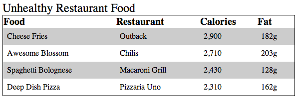

# 📄 HTML Tables

Build an HTML table of unhealthy restaurant food, then style it with CSS so it matches the
finished example.

## 🎯 Overview

In this coding exercise, you will turn a blank starter page into a data table that compares
four restaurant dishes by food, restaurant, calories, and fat. You will learn when a table is
the right element to use, how the pieces of a table fit together, and how to use CSS to add
borders, spacing, and alternating row colors so the data is easy to read.

Tables are for **tabular data** — information that belongs in rows and columns, like a
spreadsheet. They are not for page layout. Keep that in mind as you work.

> [!IMPORTANT]
> **The companion videos for this exercise are in Canvas**, on the assignment page. They
> walk you through every step, so watch them there instead of working from this file
> alone.

## 🧠 What You Will Learn

By completing this exercise, you will practice how to:

- Decide when content should be marked up as a table
- Build a table with the `table`, `tr`, `th`, and `td` elements
- Use `th` elements for column headings
- Add a title above the table
- Style a table with CSS: borders, padding, width, and text alignment
- Add alternating (zebra-stripe) row colors to make rows easier to follow
- Preview your page in a browser and compare it to a finished example

## 🎬 Watch the Videos in Canvas and Follow Along

The screencast videos are on this assignment's page in **Canvas**, not in this repo. Watch
them **in order** and follow along in your code editor. Pause whenever you need time to
finish a step — it is normal to pause, rewind, and rewatch parts of a coding demonstration.

Each video builds on the previous one, so please don't skip ahead.

| Video | What you will do |
| --- | --- |
| **Part 1 — Introduction & Overview** | Look at the starter file and the finished example, and learn what HTML tables are for. |
| **Part 2 — Building the HTML Table** | Mark up the restaurant data as a table with a heading row and one row per dish. |
| **Part 3 — Styling the Table with CSS** | Add CSS for borders, spacing, alignment, and alternating row colors to match the finished example. |

> [!IMPORTANT]
> **A few steps in this repo are different from the videos.** Follow the videos for the
> HTML and CSS, and follow this repo for getting your files and submitting:
>
> - **Getting the starter files:** don't download `tables_start.zip`. Create your own repo
>   from this template and open it with GitHub Desktop, as described in the
>   [README](README.md#-getting-started).
> - **Naming your file:** rename `table.html` to **`index.html`**, whatever name the video
>   uses. GitHub Pages only serves `index.html` at your site's root URL; any other name gives
>   you a 404. Rename the file — don't create a second one.
> - **Submitting:** don't zip your folder or upload a file. Publish your page to GitHub
>   Pages and submit a pull request URL in Canvas, as described in the
>   [README](README.md#-submitting-the-assignment).

## 🖼️ Example Output

Your finished page should look like this:

The table data:

| Food | Restaurant | Calories | Fat |
| --- | --- | --- | --- |
| Cheese Fries | Outback | 2,900 | 182g |
| Awesome Blossom | Chilis | 2,710 | 203g |
| Spaghetti Bolognese | Macaroni Grill | 2,430 | 128g |
| Deep Dish Pizza | Pizzaria Uno | 2,310 | 162g |

## 📂 Starter Files

| File | Purpose |
| --- | --- |
| `table.html` | A blank HTML page titled *Unhealthy Restaurant Food*. **Rename this to `index.html`** and build your table in it. |
| `finished.png` | Screenshot of the finished result. Use it as a reference; don't put it on your page. |

## 🧮 Grading

This exercise is worth **10 points**.

| Criteria | Full credit | Points |
| --- | --- | --- |
| **File setup** | `table.html` is renamed to `index.html` in the root folder, with the basic page structure (`DOCTYPE`, `html`, `head`, `title`, `body`) intact. | 1 |
| **Table structure** | The data is in a single `table` element, with one `tr` per row. | 2 |
| **Headings and data cells** | The column headings (Food, Restaurant, Calories, Fat) use `th`; every data value uses `td`. | 2 |
| **Content** | The page has the *Unhealthy Restaurant Food* title and all four dishes, with every value spelled and entered correctly. | 1 |
| **CSS styling** | The table has a border, padded cells, aligned text, and alternating row colors that closely match `finished.png`. | 3 |
| **Published and submitted** | The page is live on GitHub Pages, and an open pull request with the live URL is submitted in Canvas. | 1 |
| **Total** | | **10** |

## ✅ Before You Submit

Check the following:

- [ ] `table.html` has been renamed to `index.html` — and is not accidentally named `index.html.txt`
- [ ] `index.html` is in the root folder of the repo
- [ ] The page title *Unhealthy Restaurant Food* appears above the table
- [ ] The table has a heading row with Food, Restaurant, Calories, and Fat as `th` elements
- [ ] All four dishes are in their own rows, with each value in a `td`
- [ ] The table has a border and padding around the cells
- [ ] Every other row has a background color
- [ ] Your page looks like `finished.png` when you preview it in a browser
- [ ] You saved your file
- [ ] The page is live on GitHub Pages and the URL is in your pull request

## 🛠️ Troubleshooting

If something is not working, check these common issues first:

- Did you save the file?
- Is the file named exactly `index.html`?
- Is every `td` and `th` inside a `tr`, and every `tr` inside the `table`?
- Did you close every `tr`, `th`, and `td` tag?
- Does each row have the same number of cells? A missing cell shifts the columns.
- Is your CSS inside a `style` element in the `head` (or in a linked stylesheet)?
- Are your CSS selectors spelled the same as the elements or classes in your HTML?
- Did you remember the semicolon at the end of each CSS declaration?

**Having problems with the videos?**

- **Getting a warning about third-party cookies?** Try using Chrome. Safari's default
  security settings may prevent embedded Canvas videos from playing unless those settings
  are changed.
- **Getting an "Access Denied" error?** Refresh your browser. In many cases, the videos
  will load correctly after the page reloads.

## 📚 Resources

- [MDN — HTML table basics](https://developer.mozilla.org/en-US/docs/Learn_web_development/Core/Structuring_content/HTML_table_basics)
- [MDN — `<table>`: The Table element](https://developer.mozilla.org/en-US/docs/Web/HTML/Reference/Elements/table)
- [MDN — Styling tables](https://developer.mozilla.org/en-US/docs/Learn_web_development/Core/Styling_basics/Tables)
- [MDN — `:nth-child()`](https://developer.mozilla.org/en-US/docs/Web/CSS/:nth-child) — one way to stripe every other row
- [W3C Markup Validation Service](https://validator.w3.org/#validate_by_input) — paste your
  HTML in to catch unclosed tags

---

The AI policy and submission instructions are in the [README](README.md).
